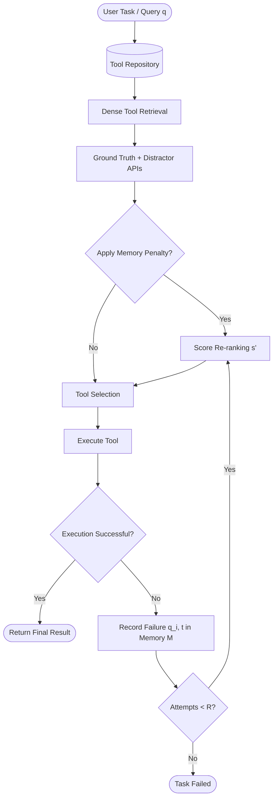
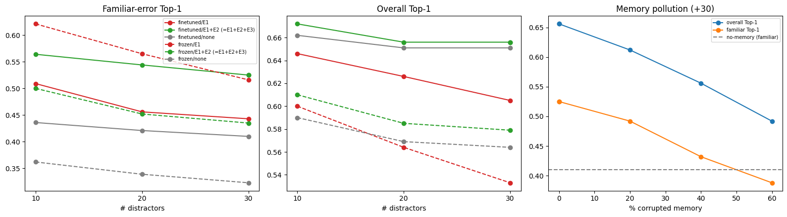

# Tool Retrieval under Distractor APIs with Memory-Based Recovery

[](https://www.python.org/)
[](https://pytorch.org/)
[](https://opensource.org/licenses/MIT)
[](https://colab.research.google.com/github/Hemal0651/tool-retrieval-memory-recovery/blob/main/notebooks/tool_retrieval_memory_recovery.ipynb)
[](paper/Tool_Retrieval_under_Distractor_APIs_with_Memory_Based_Recovery.pdf)

> **Official Repository** for the research paper:  
> *"Tool Retrieval under Distractor APIs with Memory-Based Recovery"*  
> **Authors:** **Hemal Farouqe**, **Sheikh Mainul Islam**, **Tanjida Sultana Maria**  
> 📄 **[Read Full Paper PDF](paper/Tool_Retrieval_under_Distractor_APIs_with_Memory_Based_Recovery.pdf)** | 📓 **[Interactive Notebook](notebooks/tool_retrieval_memory_recovery.ipynb)**

---

## 📌 Abstract

When LLM agents have to choose a tool from catalogues replete with near-identical descriptions (i.e., **distractor APIs**), stateless selectors are prone to making repeated errors on semantically similar queries. To address this, we implement a lightweight **retrieve–select–execute loop** backed by an **Experience Memory ($M$)**. This memory retains failed query–tool pairs and dynamically down-ranks those tools in keeping with query similarity.

We evaluate this system on a controlled benchmark constructed from **ToolAlpaca** (380 APIs, 2,695 tools, and 2,643 single-tool queries) using a fine-tuned `all-MiniLM-L6-v2` sentence encoder and cosine selector over **5 random API-level splits** with **+10, +20, and +30 mined nearest-neighbor distractors**.

### 🔑 Key Findings
- **Distractor Impact (H1)**: Adding +10 to +30 mined distractors degrades stateless baseline Top-1 from $0.674$ to $0.662$ and 3-attempt recovery from $0.920$ to $0.881$.
- **Targeted Recovery on Familiar Errors (H3)**: Similarity-weighted memory achieves a **+12.6 to +14.2 pt surge** in first-attempt accuracy on familiar errors (+30 distractors: $0.425 \rightarrow 0.551$, tool-cluster 95% CI $[+7.8, +18.0]$, positive in 5/5 splits).
- **The Familiar vs. Non-Familiar Trade-Off (H2)**: Memory provides an overall Top-1 lift (+30 distractors: $0.662 \rightarrow 0.690$, CI $[+0.3, +5.5]$), but causes a slight regression ($2.4\text{--}2.8$ pts) on non-familiar queries when ground-truth tools were previously misselected as distractors.
- **Flat vs. Similarity Weighting**: A flat ungated penalty (E1) matches familiar gains (+13.4 pts) but incurs 5× more regressions (87–99 queries regressed), resulting in net negative overall performance ($0.644$). Similarity weighting (E1+E2) prevents unconstrained suppression.
- **LLM Selector Ceilings**: An LLM selector (`openai/gpt-oss-20b` via Groq) achieves $0.811$ baseline Top-1, resolving top-5 ambiguity without measurable memory benefit ($0.816$).
- **Vulnerability to Noise / Pollution**: Corrupting $\ge 20\%$ of stored failure signals drops performance below the stateless baseline, emphasizing the necessity of filtering non-semantic errors (e.g., rate limits, network timeouts, access denials).

---

## 🔬 Methodology & Architecture

### Retrieve-Select-Execute Pipeline
The agent queries a tool repository, retrieves top candidates alongside look-alike distractors, and executes the selected tool. On failure, the query-tool pair is committed to the Experience Memory $M$, immediately updating subsequent re-rankings.



### Mathematical Formulation

#### 1. Baseline Retrieval Score
Given sentence encoder $f(\cdot)$ (`all-MiniLM-L6-v2`), candidate tools $t$ are scored by cosine similarity against query $q$:
$$s(q, t) = \cos(f(q), f(t)) = \frac{f(q) \cdot f(t)}{\|f(q)\| \|f(t)\|}$$

#### 2. Experience Memory Penalty Factor
For failed query-tool interactions $(q_i, t) \in M$, we compute the maximum semantic similarity to the incoming query:
$$\pi(q, t) = \begin{cases} \max_{(q_i, t) \in M} \cos(f(q), f(q_i)) & \text{if } \max \ge \tau \\ 0 & \text{otherwise} \end{cases}$$
Where $\tau = 0.6$ is the similarity gating threshold (tuned via grid search).

#### 3. Penalized Re-Ranking
The re-ranked score $s'(q, t)$ applies penalty weighting $\lambda = 0.3$:
$$s'(q, t) = s(q, t) - \lambda \cdot \pi(q, t)$$

#### 4. Contrastive Fine-Tuning (InfoNCE Loss)
The encoder is fine-tuned for 3 epochs with `MultipleNegativesRankingLoss`, sampling 3 hard negative distractors from the top 10 nearest neighbours:
$$\mathcal{L} = -\log \frac{\exp(s(q, t^+)/\theta)}{\exp(s(q, t^+)/\theta) + \sum_{t^-} \exp(s(q, t^-)/\theta)}$$

---

## 📊 Experimental Results

### Table 1: Pooled 5-Split Test Results
*(Fine-tuned encoder, deterministic cosine selector; $n = 1,023$ overall queries; $n = 367 / 372 / 374$ familiar-error queries at $+10 / +20 / +30$ distractors).*

| Distractors | Configuration | Overall Top-1 | Familiar Top-1 | Success $\le 3$ | Avg. Attempts |
| :---: | :--- | :---: | :---: | :---: | :---: |
| **+10** | Retry-only baseline | 0.674 | 0.439 | **0.920** | 1.490 |
| **+10** | E1 (Flat penalty) | 0.683 | **0.602** | — | — |
| **+10** | **E1+E2 (Similarity memory)** | **0.710** | 0.580 | 0.912 | **1.437** |
| **+20** | Retry-only baseline | 0.666 | 0.435 | **0.896** | 1.520 |
| **+20** | E1 (Flat penalty) | 0.663 | **0.583** | — | — |
| **+20** | **E1+E2 (Similarity memory)** | **0.698** | 0.573 | 0.890 | **1.472** |
| **+30** | Retry-only baseline | 0.662 | 0.425 | **0.881** | 1.536 |
| **+30** | E1 (Flat penalty) | 0.644 | **0.559** | — | — |
| **+30** | **E1+E2 (Similarity memory)** | **0.690** | 0.551 | 0.878 | **1.490** |

---

### Figure 2: Single-Split Evaluation & Pollution Curve

*Figure 2: Single-split (seed 42) evaluation results (`figures/results.png`). **Left and middle panels:** Familiar-error Top-1 and Overall Top-1 across +10, +20, and +30 distractors for fine-tuned and frozen encoders on seed 42. **Right panel:** Overall and familiar-error Top-1 under 0%–60% memory pollution at +30 distractors on seed 42.*

---

### Table 2: Frozen vs. Fine-Tuned Encoder Comparison (Seed 42)
*(195 test queries; 55/61 familiar error queries for fine-tuned and 58/62 for frozen at $+10/+30$ distractors).*

| Distractors | Config | Frozen Top-1 | Frozen Fam. | Fine-Tuned Top-1 | Fine-Tuned Fam. |
| :---: | :--- | :---: | :---: | :---: | :---: |
| **+10** | Baseline | 0.590 | 0.362 | 0.662 | 0.436 |
| **+10** | E1 | 0.600 | **0.621** | 0.646 | 0.509 |
| **+10** | **E1+E2** | **0.610** | 0.500 | **0.672** | **0.564** |
| **+30** | Baseline | 0.564 | 0.323 | 0.651 | 0.410 |
| **+30** | E1 | 0.533 | **0.516** | 0.605 | 0.443 |
| **+30** | **E1+E2** | **0.579** | 0.435 | **0.656** | **0.525** |

---

### Table 3: LLM Selector Evaluation (`openai/gpt-oss-20b` via Groq)
*(Single-split seed 42 test set, $+30$ distractors, top-5 candidate shortlist).*

| Configuration | $n$ | Top-1 | Familiar Top-1 ($n=34$) | Success $\le 3$ | Avg. Attempts | API Errors |
| :--- | :---: | :---: | :---: | :---: | :---: | :---: |
| **Baseline** | 180 | 0.811 | 0.500 | **0.972** | 1.233 | 11 |
| **E1+E2** | 179 | **0.816** | **0.529** | **0.972** | **1.229** | 12 |

---

### Table 4: Memory Pollution Stress Test
*(Single-split seed 42 test set, $+30$ distractors, E1+E2 configuration, $n=195$).*

| Corrupted Memory | Top-1 | Familiar Top-1 | Recall@3 | F1@3 | Avg. Attempts |
| :---: | :---: | :---: | :---: | :---: | :---: |
| **0%** | **0.656** | **0.525** | **0.836** | **0.418** | **1.549** |
| **20%** | 0.612 | 0.492 | 0.817 | 0.409 | 1.634 |
| **40%** | 0.556 | 0.432 | 0.790 | 0.395 | 1.747 |
| **60%** | 0.492 | 0.388 | 0.761 | 0.380 | 1.868 |

---

## 📂 Repository Structure

```text
tool-retrieval-memory-recovery/
├── .github/
│   └── workflows/
│       └── python-tests.yml        # CI test pipeline
├── figures/
│   └── results.png                 # Publication figure (Figure 2 in paper)
├── notebooks/
│   ├── tool_retrieval_memory_recovery.ipynb  # Primary clean reproducible notebook
│   └── original_experiments.ipynb           # Original scratch/experiment notebook
├── paper/
│   └── Tool_Retrieval_under_Distractor_APIs_with_Memory_Based_Recovery.pdf
├── scripts/
│   ├── download_toolalpaca.py      # Automated dataset cloning helper
│   ├── train_encoder.py            # CLI: Fine-tune SentenceTransformer with InfoNCE
│   ├── evaluate_splits.py          # CLI: 5-split pooled paired evaluation (Table 1)
│   ├── evaluate_pollution.py       # CLI: Memory pollution stress test (Table 4)
│   └── run_llm_selector.py         # CLI: Groq GPT-OSS-20B evaluation (Table 3)
├── src/
│   └── tool_retrieval/
│       ├── __init__.py             # Package exports
│       ├── data.py                 # ToolAlpaca parsing & API-level splitting
│       ├── distractors.py          # Nearest-neighbor mining in vector space
│       ├── encoder.py              # Contrastive trainer (MultipleNegativesRankingLoss)
│       ├── memory.py               # ExperienceMemory class (E1, E12, E123, noise)
│       ├── pipeline.py             # 2-phase warm-up/test loop with R=3 attempts
│       ├── selector.py             # Cosine & Groq LLM selectors
│       ├── stats.py                # McNemar test & tool-cluster bootstrap 95% CIs
│       └── visualization.py        # Figure 2 plotting routine
├── .gitignore
├── LICENSE                         # MIT License
├── pyproject.toml                  # Standard Python package metadata
└── requirements.txt                # Pinned dependencies
```

---

## 🚀 Quick Start

### 1. Installation
Clone the repository and install the package in editable mode:
```bash
git clone https://github.com/Hemal0651/tool-retrieval-memory-recovery.git
cd tool-retrieval-memory-recovery
pip install -r requirements.txt
pip install -e .
```

### 2. Download ToolAlpaca Dataset
Download the required `train_data.json` from ToolAlpaca:
```bash
python scripts/download_toolalpaca.py
```

### 3. Run Experiments via CLI

#### Multi-Split Pooled Evaluation (Table 1 & Hypothesis Testing)
```bash
python scripts/evaluate_splits.py --seeds 42 1 2 3 4 --distractors 10 20 30 --lam 0.3 --tau 0.6
```

#### Train Contrastive Sentence Encoder
```bash
python scripts/train_encoder.py --epochs 3 --batch_size 32 --lr 2e-5 --seed 42
```

#### Memory Corruption / Pollution Test (Table 4)
```bash
python scripts/evaluate_pollution.py --distractors 30 --rates 0.0 0.2 0.4 0.6
```

#### LLM Selector with Groq (Table 3)
```bash
export GROQ_API_KEY="your_api_key_here"
python scripts/run_llm_selector.py --model "openai/gpt-oss-20b" --distractors 30
```

---

## 👥 Team Contribution

| Member | Contribution |
| :--- | :--- |
| **Hemal Farouqe** | Overview and Context; Baseline and Extensions; Benchmark Data Pipeline |
| **Sheikh Mainul Islam** | Methodology; Encoder Fine-Tuning and Memory Implementation; Future Directions |
| **Tanjida Sultana Maria** | Related Work and Background; Results and Analysis; Multi-Split Paired Evaluation and Ablation; Discussion |

---

## 📜 Citation

If you find this work or codebase helpful in your research, please cite:

```bibtex
@article{farouqe2026tool,
  title={Tool Retrieval under Distractor APIs with Memory-Based Recovery},
  author={Farouqe, Hemal and Islam, Sheikh Mainul and Maria, Tanjida Sultana},
  journal={Antigravity Research},
  year={2026}
}
```

---

## 📄 License
This project is licensed under the **MIT License** — see the [LICENSE](LICENSE) file for details.
